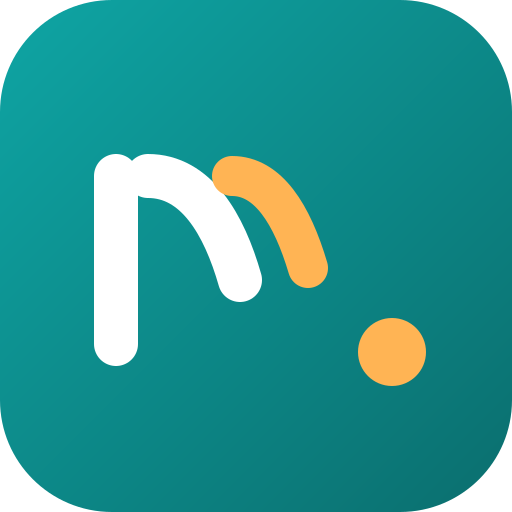

<div align="center">
  
  <h1>Morfa: Drag. Drop. Converted.</h1>
  <p><b>Tahan sebuah tombol, tarik file kamu dan jatuhkan ke sebuah format di donut yang terbuka di posisi kursor.<br/>
  Morfa mengonversi 263 format secara lokal, tanpa mengunggah apa pun.</b></p>

  <a href="https://github.com/nekonaru/morfa/releases"></a>
  <a href="https://github.com/nekonaru/morfa/actions/workflows/ci.yml"></a>
  
  
  
  
</div>

<br />

[English](README.md) | **Bahasa Indonesia**

> [!NOTE]
> Morfa mengonversi file di komputermu sendiri dan tidak pernah mengunggahnya. Morfa bekerja offline dan menyimpan hasilnya di samping file aslinya.

---

## Daftar Isi

- [Tentang](#tentang)
- [Fitur](#fitur)
- [Format](#format)
- [Kebutuhan](#kebutuhan)
- [Instalasi](#instalasi)
- [Penggunaan](#penggunaan)
- [Command Line](#command-line)
- [Bahasa Tampilan](#bahasa-tampilan)
- [Struktur Proyek](#struktur-proyek)
- [Pengembangan](#pengembangan)
- [Pengujian](#pengujian)
- [Continuous Integration](#continuous-integration)
- [FAQ](#faq)
- [Credits](#credits)
- [Author](#author)
- [Lisensi](#lisensi)

---

## Tentang

**Morfa** adalah konverter file gratis dan open-source yang kamu pakai dengan cara men-drag. Tahan sebuah tombol (Ctrl, atau Option di macOS), tarik file kamu dan jatuhkan ke sebuah format di donut yang terbuka di posisi kursor. Morfa mengonversi 263 format secara lokal: gambar, PDF, Word, Excel, PowerPoint, HWP, e-book, arsip, font, CAD, model 3D dan data geospasial berjalan tanpa Office, Hancom Office atau LibreOffice. Tidak ada yang diunggah, dan hasilnya disimpan di samping file aslinya.

Morfa terinspirasi dari, dan membangun atas, [Filee](https://github.com/KnifeLemon/Filee), konverter file open-source yang menjadi dasar reimplementasinya. Ide menu di kursor, pipeline konversi dan perancangan engine berasal dari Filee; morfa mengolah ulang basis kode, struktur proyek dan identitasnya menjadi proyeknya sendiri.

> _"Konverter file gratis dan open-source yang kamu pakai dengan cara men-drag."_

---

## Fitur

### Konversi

| Fitur | Deskripsi |
|---------|-------------|
| **Donut di kursor** | Tahan sebuah tombol, tarik file dan jatuhkan ke sebuah format; hanya format yang cocok untuk file itu yang muncul |
| **263 format, tanpa software lain** | Gambar, PDF, Word, Excel, PowerPoint, HWP, e-book, arsip, font, CAD, model 3D dan data geospasial berjalan tanpa Office, Hancom Office atau LibreOffice |
| **Langsung dari browser** | Tarik gambar, tautan ke file atau unduhan dari Chrome, Edge, Firefox atau Safari dengan cara yang sama; Morfa menyimpannya ke folder Downloads lalu mengonversinya |
| **Banyak file sekaligus, paralel** | Rute dengan beberapa langkah (HWP ke HWPX ke DOCX) ditemukan otomatis |
| **Watch folder** | Konversi setiap file yang masuk ke folder yang kamu pilih |
| **Konversi terbaru** | Setiap hasil muncul di Home dengan thumbnail: buka file itu, atau buka dengan aplikasi lain |

### Toolbar dan Preset

| Fitur | Deskripsi |
|---------|-------------|
| **Satu toolbar per tipe file** | Atur dengan drag and drop, dengan preset untuk kualitas, ukuran, DPI, halaman PDF dan kompresi, video dan audio, folder output dan nama file |
| **Dua sisi di setiap donut** | Tekan Tab atau putar roda mouse saat donut terbuka untuk membaliknya ke format dan alat yang lebih jarang |
| **Crop sebelum mengonversi** | Slice Crop membuka gambar satu per satu; geser bingkainya, pilih rasio, dan hanya bagian itu yang disimpan |
| **Potong klip** | Potong klip dari video dengan timeline, musik, fade dan penghapusan bagian sepi |

### Cara lain masuk

| Fitur | Deskripsi |
|---------|-------------|
| **Menu klik-kanan** | Konversi dengan Morfa dari Explorer, Finder atau file manager Linux kamu |
| **Pintasan keyboard** | Konversi file yang dipilih di file manager kamu |
| **Drop zone** | Jatuhkan file ke jendela Home |
| **Command line** | Perintah `morfa` memakai engine dan preset yang sama dengan aplikasi |

### Tampilan dan Bahasa

| Fitur | Deskripsi |
|---------|-------------|
| **UI English dan Indonesia** | Default English; ganti ke Bahasa Indonesia di Settings |
| **Tema** | Morfa Soft atau Material You, terang atau gelap atau ikuti sistem, dengan warna aksen dan opasitas donut pilihanmu |
| **Ukuran jendela** | Besarkan atau kecilkan setiap jendela, 70 persen sampai 180 persen |

---

## Format

| Dari | Ke |
|---|---|
| **Gambar**: JPG, PNG, WEBP, AVIF, TIFF, BMP, GIF, APNG, ICO, ICNS, JPEG XL, JPEG 2000, PSD/PSB, TGA, PPM, HEIC, QOI, DDS, PCX, MNG, CUR; GIMP XCF, kamera RAW (CR2, CR3, NEF, ARW, DNG), DICOM, OpenEXR, HDR, FITS, JPEG XR (Windows), iPhone Live Photo (LIVP) dibaca | salah satu dari ini (HEIC), PDF, SVG (ditrace), di-resize, grayscale; Live/Motion Photo ke videonya, dan video ke Live Photo (iPhone) atau Motion Photo (Android), eksperimental |
| **Vektor**: SVG, SVGZ, EMF, WMF, AI; EPS, PS; CDR, VSD, CGM, ODG, FODG | PDF (vektor), PNG dan gambar lain, SVG ke SVGZ, SVG ke DXF/DWG, PDF ke EPS/PS, SVG ke EMF, WMF, ODG |
| **PDF** | DOCX, HWPX, TXT, PNG, JPG, TIFF, CBZ, PPTX (gambar tiap halaman), SVG; merge, split, rentang halaman, kompres |
| **Dokumen**: DOCX, DOCM, DOTX, EML, Outlook MSG; OFD dibaca; DOC, ODT, FODT, OTT, RTF, WPS, WPD, Pages, ClarisWorks, MacWrite, T602 | PDF, DOCX, HWPX, EPUB, TXT, HTML; MSG ke EML; ODT, FODT, OTT |
| **Spreadsheet**: XLSX, XLSM, XLS, XLT, ODS, CSV, TSV; OTS, FODS, Numbers, ET | PDF, XLSX, ODS, CSV, TSV, JSON, HWPX, HTML; XLT, OTS |
| **Presentasi**: PPTX, PPTM, POTX, POTM, PPSX; PPT, ODP, OTP, FODP, Keynote | PDF, PNG, JPG, DOCX, HWPX; OTP |
| **HWP**: HWP, HWPX | PDF, PNG, DOCX, HWPX ke HWP, TXT, Markdown, HTML |
| **Teks**: TXT, LOG, kode skrip (PY, PAC, BAT, COMMAND; dibaca, tidak pernah dijalankan), Markdown, HTML; MHTML dibaca; reStructuredText, LaTeX, Org, AsciiDoc, Typst, MediaWiki, DocBook, Jupyter, Textile, man, OPML | UTF-8 TXT, PDF, DOCX, HWPX, EPUB; satu sama lain, slide PPTX |
| **E-book**: EPUB, KEPUB, MOBI, AZW3, AZW, AZW4, FB2, CBZ, CBR, CB7, HTMLZ, TXTZ; LIT, LRF, CHM, PDB | PDF, EPUB, KEPUB (Kobo), DOCX, TXT, HTML, HWPX; MOBI, AZW3 |
| **Video**: MP4, MOV, MKV, WEBM, AVI, WMV, FLV, MPEG, Video CD (DAT), TS, M2TS, 3GP, OGV, VOB | MP4 (H.264, HEVC, AV1), WEBM, MOV, MKV, AVI, GIF, APNG, MP3, M4A, 720p, subtitle (SRT, ASS, WebVTT) |
| **Audio**: MP3, M4A, AAC, WAV, FLAC, OGG, OPUS, WMA, AIFF, AMR, APE, WavPack, TTA, DSD (DSF, DFF), DTS, AC3, E-AC3 | MP3, M4A (AAC, ALAC), WAV, FLAC, OGG, OPUS, AAC, WavPack, TTA, W64, AC3, E-AC3 |
| **Subtitle**: SRT, ASS/SSA, WebVTT, SAMI (SMI), LRC, TTML, MicroDVD, SCC | satu sama lain sebagai UTF-8 (file Korea CP949 dibaca dengan benar) |
| **Arsip**: ZIP, ANSYS Workbench (WBPZ), 7Z, RAR, TAR, TAR.GZ, TAR.BZ2, TAR.XZ, GZ, ISO, CAB, DMG, ALZ, EGG | ekstrak, ZIP, 7Z, TAR, TAR.GZ; file apa pun ke satu ZIP |
| **CAD**: DWG, DXF | PDF, SVG, PNG, DWG ke DXF |
| **Font**: TTF, OTF, WOFF, WOFF2, EOT | satu sama lain |
| **Data**: JSON, JSON Lines, YAML, TOML, XML; vCard, iCalendar | satu sama lain, CSV dan XLSX (tabel); vCard, iCalendar ke CSV |
| **Model 3D**: GLB, glTF, STL, OBJ (+ MTL), 3MF, PLY; FBX dibaca | satu sama lain, pratinjau PNG |
| **Vektor geospasial**: Shapefile, GeoJSON, KML, KMZ, GPX; CSV dengan koordinat | satu sama lain dan CSV / XLSX / JSON; data terproyeksi (UTM, Web Mercator, Lambert, Albers) keluar sebagai WGS 84 longitude / latitude |

Format tanpa tanda berjalan langsung. Format bertanda butuh engine opsional, diunduh hanya saat dibutuhkan: Ghostscript, LibreOffice, Pandoc, calibre, FFmpeg ([detail](docs/ENGINES.md)).

---

## Kebutuhan

| Dependensi | Versi Minimum | Catatan |
|------------|-----------------|-------|
| **.NET SDK** | 10.0 | Hanya dibutuhkan untuk build dari sumber |
| **Windows** | 10 versi 1809 atau lebih baru, 64-bit | Dibutuhkan untuk menjalankan aplikasi di Windows |
| **macOS** | 13 atau lebih baru | Dibutuhkan untuk menjalankan aplikasi di macOS |
| **Linux** | Ubuntu 22.04 atau lebih baru, x64 atau ARM64 | Dibutuhkan untuk menjalankan aplikasi di Linux |

> [!TIP]
> Kalau kamu hanya ingin memakai Morfa, kamu tidak perlu .NET SDK. Unduh paketnya dari halaman [Releases](https://github.com/nekonaru/morfa/releases).

### Belum pernah pakai terminal? Mulai di sini

<details>
<summary><b>Cara membuka terminal di Windows</b></summary>

1. Tekan tombol **Windows**, ketik `PowerShell`, lalu tekan **Enter**
2. Sebuah jendela biru terbuka. Di situlah kamu mengetik perintah
3. Setiap perintah `dotnet ...` atau `git ...` di panduan ini diketik di jendela itu, lalu tekan **Enter**

</details>

---

## Instalasi

### Opsi A: Installer Windows (paling mudah)

1. Buka halaman [Releases](https://github.com/nekonaru/morfa/releases).
2. Download `Morfa-1.0.0-win-Setup.exe`.
3. Klik dua kali file yang di-download.
4. Windows SmartScreen akan menampilkan **"Windows protected your PC"**. Build ini belum ditandatangani, jadi ini normal. Klik **More info**, lalu **Run anyway**.
5. Jendela Morfa Setup muncul.

   **Install baru:** halaman Welcome menampilkan versi yang akan dipasang. Klik **Install**. Halaman progress menyelingi dengan catatan versi baru.

   **Update dari versi sebelumnya:** halaman akan memberi tahu versi lama akan diganti. Pengaturan, preset dan engine kamu tetap sama. Klik **Update**.

6. Halaman **Done** menampilkan "Morfa is ready". Klik **Launch Morfa**.
7. Morfa terbuka dan berjalan di tray. Pemakaiannya sama seperti platform lain: tahan Ctrl, tarik file, jatuhkan ke format.
8. Peluncuran pertama menanyakan engine konversi yang ingin di-download (hanya untuk video/audio dan format yang jarang). Kalau mau, lewati dulu.

Install senyap (untuk skrip dan manifest seperti winget):

```powershell
Morfa-1.0.0-win-Setup.exe /VERYSILENT /SUPPRESSMSGBOXES /NORESTART
```

Switch berguna:

| Switch | Fungsi |
|--------|--------|
| `/VERYSILENT` | Sembunyikan UI; hanya tampilkan progress |
| `/SUPPRESSMSGBOXES` | Lewati kotak pesan opsional |
| `/NORESTART` | Jangan pernah reboot setelah install |
| `/DIR="D:\Morfa"` | Tentukan folder instalasi |
| `/MERGETASKS="desktopicon,cli"` | Buat shortcut desktop dan tambah `morfa` ke PATH |
| `/NORESTART` | Jangan pernah reboot |

Setup memasang untuk all users (`%ProgramFiles%\Morfa`), membuat entry di menu Start dan shortcut desktop (kalau diminta), serta menambahkan perintah `morfa` ke PATH. Untuk menghapus, pakai **Pengaturan > Aplikasi > Aplikasi terinstal > Morfa > Uninstall**.

Jika installer tidak melakukan apa-apa atau menampilkan error, jalankan sebagai administrator.

### Opsi B: Windows portable (tanpa installer)

1. Download `Morfa-1.0.0-win-Portable.zip`.
2. Ekstrak ke folder pilihanmu (misalnya `D:\Morfa`).
3. Klik dua kali `Morfa.exe`.

Copy portable ini tidak menambahkan shortcut, menu konteks Explorer, dan commandline `morfa` ke PATH. Simpan di satu folder; memindahkannya tidak apa-apa. Untuk uninstall, cukup hapus foldernya (atau shortcut kalau kamu membuatnya).

### Opsi C: Linux (x64 / ARM64)

1. Buka halaman [Releases](https://github.com/nekonaru/morfa/releases).
2. Download `Morfa-1.0.0-linux-x64.tar.gz` (atau `-arm64.tar.gz` untuk ARM64).
3. Ekstrak:

```bash
tar xzf Morfa-1.0.0-linux-x64.tar.gz
```

4. Jalankan `./install.sh`. Script ini memasang untuk user kamu ke `~/.local/share/morfa` (atau lokasi serupa) dan menambahkan commandline `morfa`.
5. Aplikasi ini berjalan di tray.

> [!IMPORTANT]
> Gestur drag butuh X11. Di Wayland, pakai drop zone dan menu klik-kanan file manager.

### Opsi D: macOS (Apple Silicon / Intel)

1. Buka halaman [Releases](https://github.com/nekonaru/morfa/releases).
2. Download `Morfa-1.0.0-osx-arm64.dmg` (Apple Silicon) atau `Morfa-1.0.0-osx-x64.dmg` (Intel).
3. Buka DMG dan seret Morfa ke Applications.
4. Pada peluncuran pertama, izinkan lewat **Pengaturan Sistem > Privasi & Keamanan > Buka Anyway**. Aplikasi tidak di-notarize.

Atau download `osx-...tar.gz` dan jalankan `./install.sh` dari folder hasil ekstrak.

### Opsi E: Build dari sumber (untuk pengembangan / membaca atau mengubah kode)

#### 1. Ambil kode proyek

<details>
<summary><b>Saya sudah punya Git</b></summary>

```bash
git clone https://github.com/nekonaru/morfa.git
cd morfa
```

</details>

<details>
<summary><b>Saya belum punya Git</b></summary>

1. Buka halaman repositori di GitHub
2. Klik tombol hijau **`Code`**, pilih **`Download ZIP`**
3. Ekstrak ZIP ke folder pilihanmu
4. Di terminal, masuk ke folder hasil ekstrak, misalnya:

```bash
cd Downloads/morfa-main
```

</details>

#### 2. Pasang dependensi dan verifikasi

```bash
dotnet restore
dotnet build Morfa.slnx
```

> [!IMPORTANT]
> `dotnet build` harus melaporkan **0 Errors**.

#### 3. Jalankan aplikasi

```bash
dotnet run --project src/Morfa.Desktop
```

---

## Penggunaan

### Peluncuran pertama

1. Morfa muncul di area notifikasi taskbar
2. Tahan tombol pemicu (default Ctrl) dan tarik file ke donut yang terbuka di posisi kursor
3. Jatuhkan ke sebuah format untuk mengonversi

> [!NOTE]
> Tombol pemicu, toolbar donut dan watch folder diatur di Settings. Tidak ada yang berjalan otomatis.

### Pemakaian sehari-hari

- Tahan tombol pemicu dan tarik file untuk membuka donut di posisi kursor
- Tekan **Tab** atau putar roda mouse untuk membalik donut ke sisi belakangnya
- Tarik slice kembali ke donut untuk menghapusnya; klik-kanan slice atau tekan tombol edit untuk mengubahnya
- Buka **Home** untuk melihat konversi terbaru beserta thumbnail-nya
- Klik-kanan file di file manager kamu, atau pakai perintah `morfa`

---

## Command Line

Perintah `morfa` memakai engine dan preset yang sama dengan aplikasi.

```bash
morfa convert photo.heic --to jpg
morfa convert *.png --to webp --quality 80 -o converted
morfa watch D:\Inbox --to pdf --move-originals
```

Setiap perintah dan opsi: `morfa help`.

---

## Bahasa Tampilan

UI aplikasi (menu, tombol, pesan, dan pengaturan) tersedia dalam **English** (default) dan **Bahasa Indonesia**.

1. Buka **Settings**
2. Di bagian **Language**, pilih **English** atau **Bahasa Indonesia**
3. Pilihan ini diingat antar sesi

---

## Struktur Proyek

```
morfa/
├── src/
│   ├── Morfa.Domain/               # model domain: conversion, formats, presets, settings
│   ├── Morfa.Converters/            # implementasi IConverter, satu folder per engine
│   ├── Morfa.Platforms.Windows/   # layanan platform Windows
│   ├── Morfa.Platforms.Linux/     # layanan platform Linux
│   ├── Morfa.Platforms.MacOS/     # layanan platform macOS
│   ├── Morfa.Desktop/                # aplikasi desktop Avalonia
│   │   └── Assets/i18n/          # string English (en.json) dan Indonesia (id.json)
│   ├── Morfa.CommandLine/                # command line morfa
│   ├── Morfa.Installer/              # installer dan uninstaller Windows
│   └── Morfa.ExplorerMenu/       # COM server menu Explorer Windows 11 (C murni)
├── tests/                        # satu proyek test per layer
├── build/                        # skrip build, packaging dan rilis
├── installer/                    # aset instalasi Linux dan macOS
├── docs/                         # dokumentasi arsitektur dan engine
├── Directory.Build.props         # pengaturan MSBuild bersama
├── Directory.Packages.props      # versi paket terpusat
├── Morfa.slnx                    # solusi
├── LICENSE
├── README.md                     # dokumentasi utama (English)
└── README.id.md                  # dokumentasi (Bahasa Indonesia)
```

---

## Pengembangan

### Menambah converter

1. Implementasikan `IConverter` di file baru di bawah `src/Morfa.Converters`
2. Deklarasikan edge-nya di `Edges`
3. Daftarkan di `EngineRegistry.CreateAll`

> [!WARNING]
> `EngineRegistry.cs` adalah satu-satunya titik pendaftaran. Rute konversi direncanakan dari edge yang dideklarasikan, jadi engine baru membuka rute baru tanpa menyentuh kode lain.

### Menambah string yang tampil ke pengguna

1. Tambahkan key ke `src/Morfa.Desktop/Assets/i18n/en.json` (English) dan `id.json` (Indonesia)
2. Pakai lewat localizer dengan key yang sama

> [!WARNING]
> Jaga `en.json` dan `id.json` tetap sinkron. Kedua file harus punya key yang sama.

---

## Pengujian

Verifikasi sebelum setiap push, keduanya harus bersih:

```bash
dotnet build Morfa.slnx
dotnet test
```

| Pemeriksaan | Syarat |
|-------|-------------|
| `dotnet build` | Harus melaporkan **0 Errors** |
| `dotnet test` | Harus lulus seluruh suite |

Lint ditegakkan lewat `.editorconfig` dan analyzer .NET.

---

## Continuous Integration

| Workflow | Tujuan |
|----------|---------|
| `ci.yml` | Build, pemeriksaan format dan test pada setiap push ke main dan pull request |
| `portable.yml` | Build paket Linux dan macOS |
| `release.yml` | Build semua paket dan buat draft rilis GitHub pada tag `v*` |
| `label-issue.yml` | Beri label issue baru berdasarkan kata kunci |
| `label-pr.yml` | Beri label pull request dari `labeler.yml` dan judulnya |

---

## FAQ

<details>
<summary><b>Apakah Morfa mengunggah file saya?</b></summary>

Tidak. Morfa mengonversi file di komputermu sendiri dan tidak pernah mengunggahnya. Internet hanya dipakai untuk memeriksa update, mengunduh engine yang kamu pilih untuk dipasang, dan saat kamu mengklik sebuah tautan.

</details>

<details>
<summary><b>Apakah saya butuh Office atau LibreOffice?</b></summary>

Tidak untuk sebagian besar format. Gambar, PDF, Word, Excel, PowerPoint, HWP, e-book, arsip, font, CAD dan model 3D berjalan tanpa itu. Beberapa format lama atau jarang butuh engine opsional, diunduh hanya saat kamu memintanya.

</details>

<details>
<summary><b>Bagaimana cara mengubah bahasa?</b></summary>

Settings, bagian **Language**, pilih English atau Bahasa Indonesia. Default-nya English.

</details>

---

## Credits

- **Filee** ([KnifeLemon/Filee](https://github.com/KnifeLemon/Filee)), inspirasi morfa. Tahan sebuah tombol dan jatuhkan file ke aksi tipe file dari kursor. Donut toolbar, pipeline konversi dan katalog engine berasal dari rancangan dan source Filee yang berlisensi MIT.
- **Nicolas Dwi Dharma**, pengelola morfa.

---

## Author

<!-- sponsors: src/Morfa.Desktop/Assets/Sponsors/sponsors.json -->

<div align="center">

| [](https://github.com/nekonaru) |
|:---:|
| **Nicolas Dwi Dharma** |
| [github.com/nekonaru](https://github.com/nekonaru) |

</div>

---

## Lisensi

Didistribusikan di bawah **MIT License**. Lihat [`LICENSE`](LICENSE) untuk informasi lebih lanjut.
